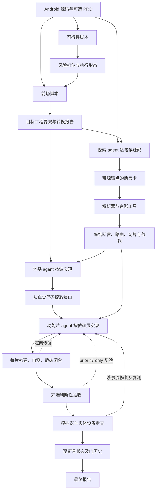
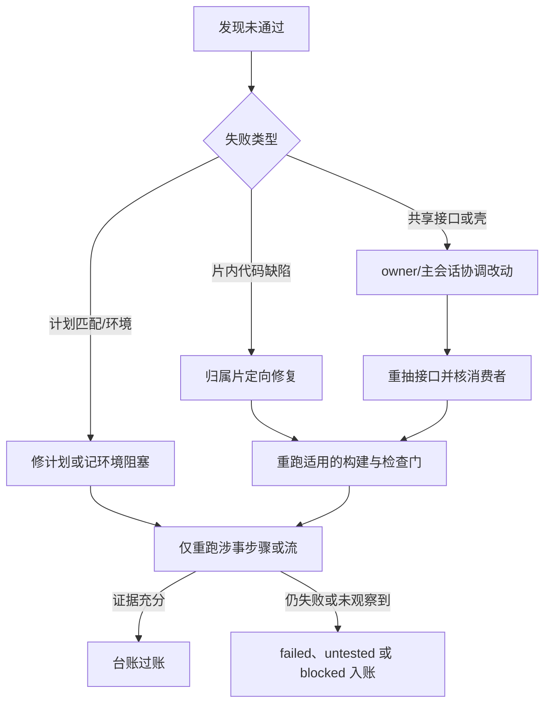
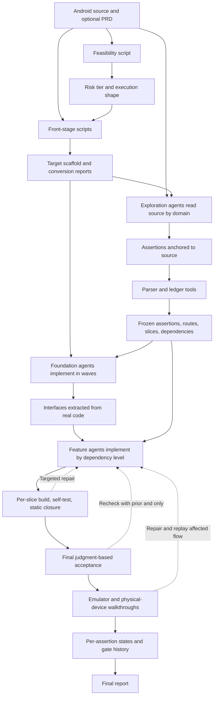
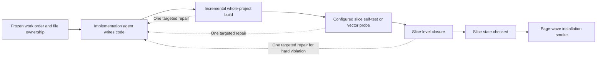
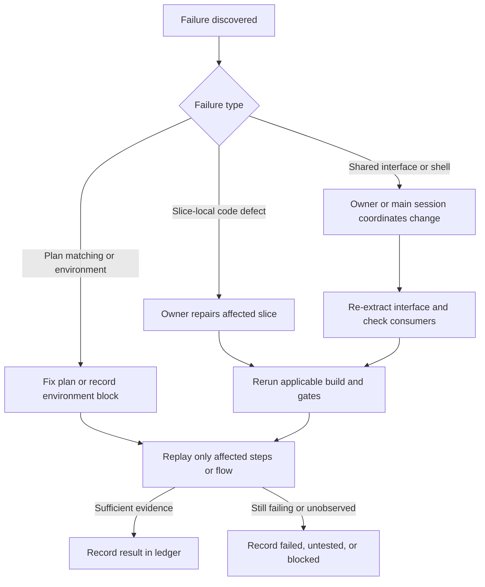

# HMigBot Migration Workflow Mechanism / HMigBot 迁移工作流原理与验证返修机制

## 中文版

本文解释当前 `migrate-core` 工作流如何把 Android 工程迁移为 HarmonyOS 工程：哪些工作由预设脚本机械完成，哪些依赖 agent 阅读源码、设计和实现，以及代码怎样经过验证、返修和最终过账。它说明的是工作流机制，不以某个项目的通过率代表该机制在所有工程上的表现。

核心认识是：**工作流不是“自动翻译整个应用”的转换器，也不是“让多个 agent 从空目录自由写代码”**。脚本先构建可编译骨架并管理可重复的检查；agent 从源码提取行为契约、按依赖实现跨平台代码；模板负责调度、隔离责任、限幅返修；最终以台账和设备证据区分“代码已写出”“静态检查通过”“行为验收通过”。

### 两大块与五个阶段

从评估角度，可以把五阶段归成两个大块：

| 大块 | 工作流阶段 | 核心产物 | 通过意味着什么 |
|---|---|---|---|
| 转译与开发 | ①可行性、②规格基线、③开发 | 目标工程骨架、源码锚定断言、冻结切片计划、ArkTS 代码、真实接口清单 | 工程已搭建并逐片通过相应的确定性检查；**不等于所有行为已被验证**。 |
| 验证、返修与收口 | ④测试、⑤发布回流 | 判断性验收结果、闭合报告、设备逐步报告、断言四态、最终报告 | 各结论必须有对应层级的证据；红门或未验项保留在最终状态中。 |

这两块不是“第一块完全开发完才第一次检查”。开发期间每片都会构建、自测和静态闭合，页面波还会做低成本装机冒烟。集中放到末端的是更贵、可能需要解释结果的行为验收与真机走查。



图中既有**产物数据流**，也有**验证证据流**。例如，目标页面源码是产物；页面通过构建的退出码、行为用例逐步报告和台账状态则是证据。两条流相互关联，却不能彼此替代。

### 输入产物和状态怎样传递

工作区中，`$SRC` 是 Android 源工程，`$DST` 是 HarmonyOS 目标工程，`$SPEC=$DST/spec` 保存迁移规格与审计产物，`$LEDGER=$SPEC/ledger` 是台账。签名、SDK、模拟器或实体设备是环境输入；PRD 可选。无 PRD 时，行为契约来自源码；有 PRD 时，源码仍定义迁移范围，而 PRD 中明确写出的可观察契约优先，差异要记录。

| 数据或状态 | 主要生产者 | 主要消费者 | 不应被误读为 |
|---|---|---|---|
| `feasibility.json` | 静态体检脚本，必要时由 agent 裁决未识别依赖 | 后续阶段的执行形态与风险处置 | 所有第三方库、系统能力都已经真实适配成功。 |
| `front/` 下的接线、资源、转译与构建/冒烟报告 | 前场脚本 | 源码探索、切片工单、首屏和路由实现 | 布局参考件就是完整页面，或骨架冒烟就是业务通过。 |
| `cards/` 短卡 | 探索 agent，按页面和无页面业务域分工 | 解析器、切片规划、验收 | 脚本自动理解了全部业务语义；卡片遗漏会影响之后的分母。 |
| `ledger/ledger.json` 与 `freeze.json` | 台账脚本写入；条目内容由源码探索与规划提供 | 实现、验收、走查、报告 | `verify` 通过代表所有功能都通过。它首先约束分母、状态和证据纪律。 |
| `instructions.md`、`conventions.md`、`slices[]` | 规划 agent 和规范模板 | 每个实现 agent 与 workflow 编排器 | 任意 agent 都能安全修改任意共享文件。 |
| `interface-manifest.json` | 从地基**实际代码**抽取的脚本 | 下游功能片及接口漂移检查 | 接口设计本身已被证明语义正确。 |
| `checked`、`accepted` 与功能断言四态 | 检查点、判断性验收、设备走查分别过账 | 最终报告与定向续跑 | 这些状态是同一级别。“checked”仅是实现期确定性门通过。 |
| `4b/*.json`、`*.report.json`、截图和原生日志 | 机械生成计划、agent 编写流计划、设备驱动与测试程序 | 设备断言过账和缺陷归因 | 计划 `ok:true` 自动覆盖未编排的交互和复合契约。 |

冻结后的路线是**向前增加证据、按失败片续跑**，不是为了提高通过率重新初始化台账、删断言或改分母。跨片契约确需变化时，先登记债务，修改拥有该接口的地基片，再重新抽取接口并复验受影响的消费者。

### 脚本搭建骨架与 agent 实现业务

#### 可行性与前场的机械工作

`feasibility.mjs` 按源码规模、文件数、页面近似数和依赖广度，结合已知平台/依赖表产生绿、黄、红建议及 `shape`：小工程可内联探索/地基，超过 small 复合阈值的工程默认进入 workflow 探索、地基波和派生风险判断。形态在开始时确定，后续阶段按该结果执行；脚本未识别或用法不明的依赖仍要 agent 查源码与 SDK 后裁决。

`front.mjs` 串起标准工程创建后的前场处理：ArkTS 测试脚手架、资源转换、路由接线、布局转译、SDK/签名检查、首次构建、切片闭合和首屏冒烟。资源脚本可迁字符串、颜色、图标等有确定映射的材料；路由脚本从清单、导航资源等真源建立统一注册表；布局脚本产出节点、尺寸和资源引用的**参考骨架**。这一步能尽快形成“可编译、可冷启、可定位路由”的目标工程。

前场不负责完整业务翻译。Android 的数据绑定、异步回调、生命周期、手势、动画、权限与平台服务，仍要 agent 对照源码和目标 SDK 重建。未映射的组件、资源和属性会成为后续实现或降级裁决的输入，不能因为项目编译成功就视为保真完成。签名或设备不可用时，相关检查按环境阻塞记录；模拟器通过不能替代要求实体硬件的结论。

#### 源码理解与规格冻结

`explore` 模板可以按领域并行派 agent 阅读源代码。页面卡描述页面可观察行为；域卡覆盖无页面的服务、协议、缓存等核心功能。每条断言应写结果契约与源码行号，区分 `ui`、`backend`、`on_device`；只有静态证据不足、需要设备观察的契约才标为 `on_device`。组件按钮、菜单、设置项应回源逐项枚举，不能只凭摘要二次概括。

分层本身也由 agent 决定，而且直接决定后续证据层级：无 PRD 时，真机清单就是 `on_device` 全集。一条依赖运行时才能成立的行为（菜单能否弹出、媒体能否播放、后台任务是否真的被调度）若被标成 `ui`/`backend`，就只会得到读码判定，永远不会进入真机走查。实践中，静态已判通过、上机才失败的缺陷大多出自这种**分层错位**，因此分层值得单独复核。

`parse-cards.mjs` 检查卡片格式、锚点和 ID，并把卡片转成台账条目；`ledger.mjs` 负责增补、状态变更、门记录、核验和报告投影。**脚本负责格式和状态纪律，断言的语义完整性仍取决于 agent 的源码阅读。** 冻结计划包括页面注册归属、功能断言、切片 owner、依赖、工单及自测命令。没有被写入分母的源行为，不会被“113 条里通过了多少”这种数字自动发现。

### 代码开发怎样分工与合入

先做共享地基，再做消费者。地基通常包含应用初始化、模型/单位、协议与网络客户端、存储、系统能力适配和共享服务。`implement.js` 按 `wave` 顺序推进，不同波之间有先后；同波的独立单元可并行。地基过门后，`interface.mjs extract` 从已写出的代码导出接口清单，下游片只能依赖该清单中的真实符号。

功能切片形成依赖图：页面是数据和服务的消费者，backend/platform 片不能反向依赖页面；每个注册路由的页面文件必须归某个片所有。`mig_slices.js` 在启动时检查依赖闭包、循环及路由归属，按依赖层调度。无依赖冲突的同层切片可同时**实现**，但每片的全工程构建、已配置的自测和闭合检查进入受锁保护的检查点；另一片仍在写文件导致构建暂时变红时，可根据文件归属延后复检，避免错误归责。

这并不是为每个 agent 建独立 Git 分支、最后一次性合并。agent 通常操作同一工程目录：工单的 `targetPath` 限定可改文件；共享路由壳、配置或接口若需要修改，应作为 `blocked/sharedEdits` 报给集成步骤或主会话。文件边界、路由归属、接口检查和串行检查点共同降低冲突，但**工单约束不是不可越过的文件系统隔离**，仍可能有跨片语义冲突。每波/每片要检查，末端再做全局验收。

实现期单片流程如下：


这里的“合入”更接近**代码写入共享工作树后及时过门**，而非最后合并多个分支。某片构建、其已配置的自测或闭合未收敛，不应先记为 `checked`、再寄希望于最终验收补救。

#### UI 为什么可能近似，为什么又不能保证等价

UI 有四类输入：源布局 XML/Compose 结构，文案/图片/尺寸等资源，处理点击和状态的源码，以及转译器生成的布局参考件。UI 实现 agent 需把这些信息编入目标注册页与组件，再根据 `ui-layout-semantics.md` 处理两端默认值的差别，例如容器对齐、图片缩放、锚定、滚动、标题栏、安全区和层叠点击。这些差别往往**语法合法、编译成功、属性看似对应**，却会使目标页面位置或交互不同。

复杂动画、图表、模糊/弹层等没有简单一对一映射时，agent 可以提出视觉或动画近似，但需登记为降级候选并保留行为契约；“近似”不是功能断言的自动豁免。UI 保真还依靠设备控件树/几何、截图和真实手势复核。当前工作流没有一套能自动证明源端与目标端逐像素等价、并完整识别动画时序和复合手势的统一门。

### 静态检查的机器门和模型验收

“静态检查”不是一个单独步骤，至少有两层：

| 层 | 执行者 | 检查与结论 |
|---|---|---|
| 确定性检查 | `hvigorw`、向量/探针与 `closure-suite.mjs` 等脚本 | 构建是否成功；已配置的算法/协议测试是否通过；注册路由、资源引用、接口消费者、桩代码、权限、易抛 API、字面锚点、安全区、死文件等是否存在可扫描的违规或立案。以退出码和报告裁决覆盖范围内的事实。 |
| 判断性读码验收 | `acceptance.js` 派出的只读 verify agent | 对照每片冻结断言，阅读目标代码与源码锚点，提交可定位的“满足/不满足/需设备验证”判词。它是模型判断，不等于脚本已机械证明行为。 |

闭合套件按阶段收紧：`slice` 先拦路由/资源等“任何时候都错”的问题；`integration` 扩大到消费者、桩、权限、API guard、安全区、锚点等；`final` 要求未裁决的软立案被修复或以有依据的票据处理。脚本提出 `violation`、`case` 或 `unresolved`，agent 需回源码、SDK 声明和实际用法裁决；不能把所有软案批量豁免。

通过构建与闭合只能记代码处于 `checked` 等实现期状态。`accepted` 是末端行为验收结论；运行时专属断言要在设备层独立过账。最终 `ledger verify` 核的是台账、证据及必需门记录是否合规，**不会把值为 false 的门自动改成 true**。台账对设备层也有机械约束：以 `--layer device` 过账时，证据必须指向某份走查报告中状态为 ok 的步（`<名>.report.json#<步号>`），否则拒绝写入；设备层结论不会被之后的静态判断覆盖。

### 动态验证中的 JSON 用例和执行器

动态验证确实采用**JSON 步骤计划**，但不是脚本自动从每条断言生成完整交互测试。计划有两类：

1. `walk.mjs plan` 能从台账为带路由的片机械生成逐页计划：直达目标路由、确认进程存活、`probe` 当前页可能出现的字面量、截图。`probe` 只记出现率，未见不直接判失败，因为文案可能只在错误、保存后或特定数据状态下出现。
2. 跨页行为流由 agent 根据断言和页面字典编排，例如“清数据冷启→设置非默认值→返回→重新冷启→期待该值仍存在”。有 PRD 时，编号场景全集也应映射进流计划；无 PRD 时，清单来自台账的 `on_device` 全集，加核心路径页序，不能把少量核心流说成完整 PRD 场景覆盖。

一个抽象用例可以写成：

```json
{
  "bundle": "example.bundle",
  "name": "preference-restoration",
  "steps": [
    { "op": "start", "fresh": true },
    { "op": "tap", "match": "=Settings" },
    { "op": "tap", "match": "=Non-default option" },
    { "op": "expect", "match": "=Non-default option" },
    { "op": "key", "name": "Home" },
    { "op": "start" },
    { "op": "expect", "match": "=Non-default option" },
    { "op": "shot", "name": "restored" }
  ]
}
```

`walk.mjs run` 读取步骤后，以设备命令和控件树执行 `start`（可带 `route`、`fresh`）、`tap`、`type`、`key`、`back`、`swipe`、`scrollUntil`、`wait`、`expect`、`probe`、`sleep`、`shot`、`alive`、`stop` 等步骤；`dump` 是查看控件树的命令行子命令，不是计划中的步骤。它机械匹配文本、ID、类型和范围；点击后记录控件树是否变化；保存截图、几何、前台/存活、崩溃、失败步与错误种类（如目标缺失、目标歧义、预期文本缺失、进程死亡）。`expect`、`wait` 等显式条件由脚本直接判成功或失败，报告逐步保留结果。脚本的截图不是自动视觉裁判，`tap.changed=true` 也不保证目标业务状态正确。

因此职责链准确地说是：**断言/场景 → agent 设计有观察点的 JSON 流 → 脚本机械执行并判断显式步骤条件、收集证据 → agent 对照源码/PRD 判整体契约是否被充分证明 → 台账过账。** 流报告 `ok:true` 只表示已编排的步骤执行成功；未编排的刷新竞态、动画中间帧或列表边界，不会凭空得到验证。

执行器还有几处**够不到的地方**，规划流时应预先识别：
- **系统界面：** 通知栏、桌面小组件内容、系统分享面板中的应用图标、交出给系统文件选择器之后的界面，多数不在应用控件树里，`match` 无法定位。SKILL 又禁止自行计算坐标注入操作，所以依赖这些界面的 `on_device` 契约，在现有规则内往往只能记 untested；若要验证，需要扩展执行器（例如带截图留证的坐标操作）。
- **输入：** `type` 是在原有内容后追加，不会先清空。
- **滑动：** 整屏 `swipe`/`scrollUntil` 在软键盘弹出时可能落在键盘上，变成误输入。
- **非界面结果：** 语音合成发声、振动、后台调度等结果不体现在控件树上，只能靠系统日志留证；日志缓冲有限，长流程要在执行期间实时过滤保存。

设备验证还需注意两种启动方式：`start --route` 可直接进入页面，适合逐页可达性探测，却会绕过首页初始化；持久化契约必须正常冷启并经应用内导航验证，且重启前先设置**非默认值**。直达启动的副作用不止于此：首页没有接管导航，同一进程里之后到来的深链、通知点击可能只被暂存而不执行，使同一流程的后续步骤误判失败；因此跨页流程应以正常冷启开头。`start` 的 `fresh: true` 会清空应用数据，多份计划依次执行时会互相影响，需要固定执行顺序或在流程开头自备数据。模拟器能证明一定的 UI/流程事实，但要求真实硬件、系统权限或原生模块的断言需相应的实体设备证据。

### 返修怎样回到正确的检查点

返修不是发现任何失败就重跑全流程，也不是一次修复后直接把断言记通过。不同层的失败回到不同位置：

| 失败发生处 | 返修动作 | 修后至少回到哪里 | 未收敛时 |
|---|---|---|---|
| 实现期构建、自测、切片闭合 | 只派涉事片修复，检查点做有限次数重试；跨片共享修改交 owner/主会话 | 该片构建、自测、闭合；页面波的冒烟 | 保留失败/blocked，不推进为 `checked`。 |
| 波级装机冒烟 | 先分环境阻塞、崩溃、着陆错误、空态/登录墙等；只对归因明确的错误改代码 | 涉事路由冒烟 | 环境问题记 blocked；软案留待末端裁决；崩溃不收敛则停。 |
| 末端判断性验收 | 首轮只读验收应一次列出该单元全部不达标项；不同失败单元可并行定向修，不能改非归属文件 | 修后全工程构建，再仅复验失败单元与 prior 判词 | 限幅轮次后记失败，并保存 `priorFile`，下次用 `only/resumeFrom` 续跑。 |
| 设备行为流 | 先判断是计划目标写错、环境不满足，还是应用真实缺陷；仅真实缺陷改相关片 | 涉事流复测一次，并更新该断言设备证据 | 仍失败记 failed；未观察到留 untested，不以操作成功充当行为通过。 |

多个独立修点可以按**切片所有权**并行修；涉及同一共享文件或接口的修点应协调归并，随后做一次构建与必要的消费者复验。验收模板会在一轮并行修复后进行整体构建，再把失败单元送入限幅复验；它不会自动重新验所有已 accepted 的单元。设备阶段更强调单缺陷的目标化修复和一次复测，以防无限 fix-loop。具体有三道硬限制：
- 同一缺陷只允许一次定向修复加一次复验，仍失败即记 failed、不再改码；
- 4b 走查有时间盒（无 PRD 时 small 档 15 分钟、standard 档 30 分钟；有 PRD 时按场景数给，上限 90 分钟），修复与复验计入，超时未走到的转 untested；
- 把问题归因为平台缺陷或写成通用规则前，须完成"归因三步"：复现（≥2 次）、反转条件（单变量撤掉/装回各 ≥2 次）、必要时在空工程中隔离；单次归因时间盒 30 分钟。

这些限制让工作流在有限成本内收口，代价是复杂缺陷可能停在 failed：此时结果反映的是**流程上限**，不一定是问题本身无法解决。若契约变更影响地基接口，还须记录债务、重抽接口清单并复验受影响的下游片。



### 速度优势和质量风险应分开评价

这套结构的主要优势，是把确定性、可重用的工作前置：工程创建、资源和路由、布局参考、台账、构建、闭合和设备驱动不必每轮重新发明；探索与同层实现可以并行；接口、文件所有权、冻结分母和 `only` 续跑降低多人协作的反复劳动。可编译骨架通常出现得比完整功能验收更早，这是设计目标，而不是质量问题。

评价质量时，则应重点检查以下边界：

- **分母风险：** 源码契约由 agent 提取；冻结只能防止事后缩分母，不能发现一开始漏掉的源行为。重要场景最好有独立 PRD、源端操作或人工审查对照。
- **UI 风险：** 布局转译只搬部分结构/属性，跨平台默认值和动态手势依赖人工语义映射与设备观察；没有统一的自动像素等价证明。
- **并行风险：** `targetPath` 和 owner 主要是编排与工单约束；共享工作树、共享状态和接口设计仍可能产生跨片冲突，构建绿灯只拦其中一部分。
- **验证覆盖风险：** 自动逐页计划是出现率/可达性探测，不是完整行为测试；agent 编写的核心流覆盖了哪些状态转换，决定了它能证明什么。`ok:true` 不能扩大解释到计划之外。
- **晚发现风险：** 判断性行为验收集中在末端，降低重复验收成本，也意味着跨片时序、持久化和复杂 UI 缺陷可能到较晚才暴露。
- **环境风险：** SDK、签名、网络、模拟器与实体设备的能力会影响可验证层级；环境阻塞和功能失败须分开，不能用模拟器或静态结论替代真机专属契约。
- **分层风险：** 断言的 `on_device` 归类由 agent 决定；依赖运行时的行为被归为静态层后，只会得到读码结论，不会被真机检验。
- **工具自身风险：** 确定性门也会误报或漏报。例如主机侧单元测试运行时可能把部分平台 API 实现为空桩，导致向量测试假失败；闭合扫描对非标准入口（如卡片配置、自定义避让、特殊路由写法）可能识别不到；报告投影的字段可能与裁决后的状态不一致。门的结论要结合其真实覆盖范围理解。
- **引擎依赖：** 模板依赖特定 workflow 引擎提供的内置能力（执行确定性命令、读取规格片段、参数注入）。换到不提供这些能力的引擎时，需要适配层；适配层的执行方式（例如由轻量代理代为执行命令）会改变会话数与成本结构，评估时应单独计入。

最终的评估单位应是**某项能力及其证据层级**，不是单独的“构建成功”“走查脚本成功”或“总通过率”。一个可靠结论应能沿着源码或 PRD 契约、目标实现、测试计划、逐步设备报告和台账状态反向追溯。

### 关键组件速查

| 组件 | 在机制中的职责 |
|---|---|
| `SKILL.md` | 五阶段顺序、停止条件、冻结与路径纪律、任务分工的规范来源。 |
| `scripts/feasibility/feasibility.mjs`、`scripts/front.mjs` | 环境和源码体检、前场自动化串联。 |
| `scripts/convert/`、`scripts/wire/`、`scripts/transpile/` | 资源转换、统一路由生成、布局参考骨架。 |
| `templates/explore.js`、`templates/implement.js`、`templates/mig_slices.js` | 按域探索、按波地基开发、按依赖层开发及检查点编排。模板调用 agent，但不自行编写业务语义。 |
| `scripts/ledger/parse-cards.mjs`、`scripts/ledger/ledger.mjs` | 卡片机械解析、台账状态/门/证据管理、报告投影。 |
| `scripts/interface/interface.mjs`、`scripts/closure/closure-suite.mjs` | 从真代码抽取接口、分阶段静态闭合和立案。 |
| `templates/acceptance.js` | 末端模型验收、并行失败修复、限幅复验、prior 判词和过账。 |
| `scripts/smoke/smoke.mjs`、`scripts/smoke/walk.mjs` | 低成本装机冒烟；设备操作计划的机械执行、逐步条件判定与证据收集。 |

文中的“脚本可判定”均限于脚本真实检查的输入和条件；“模型可判断”也须附源码、代码位置或设备步骤等证据。把两者的能力边界保留下来，是理解整个工作流最快也最重要的一步。

---

## English version

This document explains how the current `migrate-core` workflow migrates an Android project to HarmonyOS: which tasks predefined scripts perform mechanically, which tasks require agents to read source code, design, and implement, and how the result moves through verification, repair, and final accounting. It describes the workflow mechanism; one project's pass rate is not evidence of how the mechanism will perform on every project.

The central distinction is that **the workflow is neither a converter that automatically translates an entire app nor a group of agents writing freely in an empty directory**. Scripts first create a buildable scaffold and manage repeatable checks. Agents derive behavioral contracts from the source and implement cross-platform code in dependency order. Templates coordinate work, establish ownership boundaries, and limit repair attempts. The ledger and device evidence distinguish “code written,” “deterministic checks passed,” and “behavior accepted.”

### Two blocks and five phases

For evaluation, the five phases can be grouped into two blocks:

| Block | Workflow phases | Main outputs | What passing means |
|---|---|---|---|
| Translation and development | ① Feasibility, ② specification baseline, ③ development | Target scaffold, source-anchored assertions, frozen slice plan, ArkTS code, manifest of real interfaces | The project has been set up and each slice has passed its applicable deterministic checks; **it does not mean every behavior has been verified**. |
| Verification, repair, and closure | ④ Testing, ⑤ release feedback | Judgment-based acceptance, closure reports, step-by-step device reports, four assertion states, final report | Each conclusion requires evidence at the corresponding level; failed gates and untested items remain visible in the final state. |

This division does not mean that checking starts only after all development is complete. Each development slice is built, self-tested, and statically closed; page waves also receive inexpensive installation smoke checks. The more costly behavioral acceptance and device walkthroughs, whose results may require interpretation, are concentrated toward the end.



The diagram shows both an **output data flow** and a **verification evidence flow**. Target page source is an output; a successful build exit code, step-by-step behavioral report, and ledger status are evidence. They are related but cannot substitute for one another.

### How inputs, outputs, and states move

In the workspace, `$SRC` is the Android source project, `$DST` the HarmonyOS target, `$SPEC=$DST/spec` the migration specification and audit outputs, and `$LEDGER=$SPEC/ledger` the ledger. Signing, SDKs, an emulator, and physical devices are environment inputs; a PRD is optional. Without a PRD, behavioral contracts come from source code. With one, source code still defines migration scope, while explicit observable contracts in the PRD take precedence and discrepancies must be recorded.

| Data or state | Main producer | Main consumer | What it does **not** establish |
|---|---|---|---|
| `feasibility.json` | Static inspection script, with agent adjudication for unknown dependencies where needed | Execution shape and risk handling in later phases | That every third-party library and platform capability has been successfully adapted. |
| Wiring, resource, translation, build, and smoke reports under `front/` | Front-stage scripts | Source exploration, slice work orders, first screen and route implementation | That a layout reference is a complete page or scaffold smoke success is business-function success. |
| Short cards under `cards/` | Exploration agents divided by page and non-page domain | Parser, slice planning, acceptance | That a script has understood all business semantics; omissions affect the later denominator. |
| `ledger/ledger.json` and `freeze.json` | Written by ledger scripts from exploration and planning content | Implementation, acceptance, walkthroughs, reporting | That `verify` means all features passed. It first enforces denominator, state, and evidence discipline. |
| `instructions.md`, `conventions.md`, and `slices[]` | Planning agents and specification templates | Implementation agents and workflow orchestrator | That any agent may safely edit any shared file. |
| `interface-manifest.json` | A script extracting interfaces from the foundation's **actual code** | Downstream slices and interface-drift checks | That the interface design itself is semantically correct. |
| `checked`, `accepted`, and the four feature-assertion states | Checkpoints, judgment-based acceptance, and device walkthroughs respectively | Final report and targeted continuation | That these are equivalent states. `checked` only denotes applicable implementation-time deterministic gates. |
| `4b/*.json`, `*.report.json`, screenshots, native logs | Mechanical plan generation, agent-authored flows, device driver and test program | Device assertion accounting and defect attribution | That `ok:true` covers interactions and compound contracts absent from the plan. |

Once the plan is frozen, the intended direction is to **add evidence and resume failed slices**, not to reinitialize the ledger, remove assertions, or change the denominator to improve a pass rate. If a cross-slice contract must change, record the debt, modify the foundation slice that owns the interface, re-extract it, and recheck affected consumers.

### Scripts scaffold the project; agents implement behavior

#### Mechanical feasibility and front-stage work

`feasibility.mjs` considers source size, file count, approximate page count, and dependency breadth alongside known platform and dependency tables. It produces green/yellow/red guidance and an execution `shape`: a small project may use inline exploration and foundation work; a project above the composite small threshold defaults to workflow-based exploration and foundation waves with derived risk assessment. The shape is established at the outset and governs later phases. An agent still has to inspect source usage and SDK support to decide what an unrecognized or ambiguous dependency means.

`front.mjs` coordinates front-stage processing after creation of a standard target project: ArkTS test scaffolding, resource conversion, route wiring, layout translation, SDK and signing checks, initial build, slice closure, and first-screen smoke. Resource scripts can carry over strings, colors, icons, and other materials with deterministic mappings. Route scripts build a common registry from authoritative sources such as the manifest and navigation resources. Layout scripts produce a **reference scaffold** of nodes, dimensions, and resource references. This quickly yields a target project that can build, cold-start, and identify routes.

The front stage does not fully translate business behavior. Agents must reconstruct Android data binding, asynchronous callbacks, lifecycle behavior, gestures, animation, permissions, and platform services against the source and target SDK. Unmapped components, resources, and attributes become inputs to later implementation or a documented degradation decision; a successful compile is not proof of fidelity. If signing or a device is unavailable, its associated checks are recorded as environment-blocked. Emulator success cannot replace evidence that requires physical hardware.

#### Source understanding and specification freeze

The `explore` template can dispatch agents by domain to read the source in parallel. Page cards describe observable page behavior; domain cards cover non-page services, protocols, caches, and other core features. Each assertion should state an outcome contract with source line anchors and distinguish `ui`, `backend`, and `on_device`. Only contracts that lack sufficient static evidence and require device observation should be marked `on_device`. Buttons, menus, and settings must be enumerated from the source, rather than reconstructed from a high-level summary.

The layer is itself an agent decision, and it determines the evidence level that follows: without a PRD, the device checklist is exactly the `on_device` set. A behavior that only holds at runtime (a menu opening, media playing, a background task actually being scheduled) that is labelled `ui`/`backend` receives only a code-reading judgment and never reaches a device walkthrough. In practice, most defects that passed statically and failed on device come from this **layer misclassification**, so the layering deserves its own review.

`parse-cards.mjs` checks card formatting, anchors, and IDs, then converts the cards into ledger entries. `ledger.mjs` manages additions, state changes, gates, verification, and report projection. **Scripts enforce format and state discipline; semantic completeness still depends on an agent's source reading.** The frozen plan includes page-registration ownership, feature assertions, slice owners, dependencies, work orders, and self-test commands. A source behavior omitted from the denominator will not be discovered merely by reporting how many of a given number of assertions passed.

### How development is divided and integrated

Shared foundations come before their consumers. They normally include app initialization, models and units, protocol and network clients, storage, platform-capability adapters, and shared services. `implement.js` advances in `wave` order; independent units within a wave may run concurrently. Once the foundation passes its gates, `interface.mjs extract` exports an interface manifest from the code that was actually written. Downstream slices may depend only on real symbols in that manifest.

Feature slices form a dependency graph: pages consume data and services, while backend/platform slices must not depend backward on pages. Every registered route's page file must have a slice owner. At launch, `mig_slices.js` checks dependency closure, cycles, and route ownership, then schedules by dependency level. Non-conflicting slices at the same level can be **implemented concurrently**, but each slice's whole-project build, configured self-test, and closure enter a lock-protected checkpoint. If another slice is still editing files and temporarily makes the build red, file ownership can justify deferring a recheck rather than misattributing the failure.

This is not a separate Git branch for every agent followed by one final merge. Agents usually work in the same project directory: a work order's `targetPath` limits the files it should change. Changes needed in a shared route shell, configuration, or interface should be reported as `blocked/sharedEdits` to integration or the main session. File boundaries, route ownership, interface checks, and serial checkpoints reduce conflicts, but **a work-order constraint is not unbreakable filesystem isolation**. Cross-slice semantic conflicts remain possible. Checks happen per wave and slice, followed by global acceptance near the end.

The implementation-time flow for one slice is:



Here, “integration” means **passing gates promptly after code lands in the shared working tree**, not a final merge of isolated branches. A slice whose build, configured self-test, or closure has not converged should not be marked `checked` in the hope that final acceptance will repair it.

#### Why UI may look similar without guaranteed equivalence

UI implementation has four input classes: source XML/Compose layout structure; strings, images, dimensions, and other resources; source code handling clicks and state; and the translated layout reference. UI agents incorporate these into registered target pages and components, then use `ui-layout-semantics.md` to address differences in platform defaults, including container alignment, image scaling, anchoring, scrolling, title bars, safe areas, and layered hit testing. A page may have legal syntax, compile, and appear to map attributes correctly while still placing elements or handling interaction differently.

When complex animation, charts, blur, overlays, or similar effects lack a one-to-one mapping, an agent may propose a visual or animated approximation. It must be recorded as a degradation candidate while preserving the behavioral contract; “approximate” is not an automatic waiver of a feature assertion. UI fidelity also depends on checking device control trees and geometry, screenshots, and real gestures. The current workflow has no single gate that automatically proves pixel-by-pixel equivalence between source and target or completely recognizes animation timing and compound gestures.

### Deterministic static gates and model-based acceptance

“Static checking” is not one step. It has at least two layers:

| Layer | Executor | Check and conclusion |
|---|---|---|
| Deterministic checks | `hvigorw`, vector/probe tests, `closure-suite.mjs`, and related scripts | Whether the build succeeds; configured algorithm/protocol tests pass; and registered routes, resource references, interface consumers, stub code, permissions, exception-prone APIs, literal anchors, safe areas, and dead files contain scannable violations or cases. Exit codes and reports decide facts within the checks' actual coverage. |
| Judgment-based code acceptance | Read-only verify agents dispatched by `acceptance.js` | Agents compare each frozen slice assertion with target code and source anchors, then give locatable judgments of “satisfied,” “not satisfied,” or “needs device verification.” This is model judgment, not a mechanical proof of behavior. |

Closure grows stricter by stage. `slice` first blocks issues such as routes and resources that are wrong at any time. `integration` expands to consumers, stubs, permissions, API guards, safe areas, and anchors. `final` requires unresolved soft cases to be fixed or handled with justified tickets. Scripts raise `violation`, `case`, or `unresolved`; agents must adjudicate using source, SDK declarations, and actual usage rather than waiving all soft cases in bulk.

Passing a build and closure only supports implementation-time states such as `checked`. `accepted` is the final behavioral acceptance conclusion; runtime-only assertions are accounted for independently at the device layer. Final `ledger verify` checks whether the ledger, evidence, and required gate records obey the rules; **it does not change a false gate to true**. The ledger also constrains the device layer mechanically: a `--layer device` posting must cite an ok step in a walkthrough report (`<name>.report.json#<step>`) or it is rejected, and a device-layer conclusion cannot later be overwritten by a static judgment.

### JSON test cases and the dynamic executor

Dynamic verification does use **JSON step plans**, but the script does not automatically generate a complete interaction test from every assertion. There are two plan types:

1. `walk.mjs plan` can mechanically create per-page plans for slices with routes: open the target route directly, check that the process remains alive, `probe` for possible page literals, and capture a screenshot. A `probe` records a hit rate but does not fail merely because text is absent; the text may appear only in an error state, after saving, or with particular data.
2. Agents compose cross-page behavioral flows from assertions and the page dictionary, such as “clear data and cold-start → set a non-default value → return → cold-start again → expect the value to persist.” With a PRD, its complete set of numbered scenarios should also map to flow plans. Without a PRD, the checklist comes from all ledger `on_device` assertions plus core-path page sequences; a few core flows must not be described as complete PRD scenario coverage.

An abstract test case could be:

```json
{
  "bundle": "example.bundle",
  "name": "preference-restoration",
  "steps": [
    { "op": "start", "fresh": true },
    { "op": "tap", "match": "=Settings" },
    { "op": "tap", "match": "=Non-default option" },
    { "op": "expect", "match": "=Non-default option" },
    { "op": "key", "name": "Home" },
    { "op": "start" },
    { "op": "expect", "match": "=Non-default option" },
    { "op": "shot", "name": "restored" }
  ]
}
```

`walk.mjs run` reads the steps and uses device commands and the control tree to perform steps such as `start` (optionally with `route` or `fresh`), `tap`, `type`, `key`, `back`, `swipe`, `scrollUntil`, `wait`, `expect`, `probe`, `sleep`, `shot`, `alive`, and `stop`; `dump`, which prints the control tree, is a command-line subcommand rather than a plan step. It mechanically matches text, IDs, types, and ranges; records whether the control tree changed after a tap; and saves screenshots, geometry, foreground and liveness state, crashes, the failing step, and error types such as missing or ambiguous targets, absent expected text, and process death. Explicit `expect` and `wait` conditions are judged directly by the script, with results retained step by step. A screenshot is not an automatic visual verdict, and `tap.changed=true` does not prove that the intended business state is correct.

The accurate responsibility chain is therefore: **assertion/scenario → agent designs a JSON flow with observation points → script executes steps, evaluates explicit conditions, and collects evidence → agent decides whether the whole contract is sufficiently demonstrated against source/PRD → ledger records the result.** A flow report with `ok:true` means its planned steps succeeded; it does not verify an unplanned refresh race, intermediate animation frame, or list boundary.

The executor also has **blind spots** that flow planning should anticipate:
- **System UI:** the notification shade, home-screen widget content, app icons in the system share sheet, and screens after control passes to the system file picker are mostly outside the app's control tree, so `match` cannot target them. SKILL also forbids injecting self-computed coordinates, so `on_device` contracts that depend on these surfaces can often only be recorded as untested within the current rules; verifying them requires extending the executor (for example, coordinate operations backed by screenshots).
- **Input:** `type` appends to existing content; it does not clear the field first.
- **Swipes:** a full-screen `swipe`/`scrollUntil` can land on the soft keyboard when it is open and turn into stray input.
- **Non-UI results:** speech output, vibration, and background scheduling leave no trace in the control tree and can only be evidenced through system logs; log buffers are limited, so long flows need live filtering during execution.

Device verification must also distinguish two launch modes. `start --route` can enter a page directly and is useful for reachability probes, but it can bypass home-screen initialization. Persistence contracts require a normal cold start and in-app navigation, with a **non-default value** set before restart. The side effects of a direct launch go further: because the home screen never takes over navigation, later deep links or notification taps in the same process may be stashed rather than handled, so later steps in the same flow can fail falsely; cross-page flows should therefore begin with a normal cold start. `fresh: true` on `start` clears app data, so plans run in sequence can affect one another; fix their execution order or have each flow seed its own data. An emulator can establish certain UI and flow facts, but assertions requiring real hardware, system permissions, or native modules need corresponding physical-device evidence.

### Returning repairs to the right checkpoint

Repair is neither a full restart after every failure nor a direct pass after a code change. Different failures return to different checkpoints:

| Failure point | Repair action | Minimum post-repair recheck | If it does not converge |
|---|---|---|---|
| Implementation build, self-test, slice closure | Dispatch repair only to the affected slice, with bounded checkpoint retries; send cross-slice shared changes to their owner or the main session | That slice's build, self-test, closure, and page-wave smoke where applicable | Keep failure/`blocked`; do not advance to `checked`. |
| Wave-level installation smoke | First distinguish environment blockage, crash, wrong landing, empty state, login wall, and similar cases; change code only for attributable defects | Smoke on the affected route | Record environment issues as `blocked`; retain soft cases for final adjudication; stop on an unresolved crash. |
| Final judgment-based acceptance | The first read-only pass should enumerate all shortcomings in a unit; separate failing units may receive parallel targeted repairs without editing files they do not own | Whole-project build, then reverify only failing units against their prior judgments | After bounded rounds, record failure and preserve `priorFile`; next run continues with `only/resumeFrom`. |
| Device behavioral flow | Determine whether the plan targets the wrong control, the environment is insufficient, or the app has a real defect; edit the relevant slice only for a real defect | Replay the affected flow once and update the assertion's device evidence | Record continued failure as `failed` and unobserved behavior as `untested`; successful operations alone do not prove behavior. |

Independent repairs may proceed in parallel **according to slice ownership**. Repairs touching the same shared file or interface must be coordinated, followed by a build and any necessary consumer rechecks. After a round of parallel acceptance repairs, the template builds the whole project and sends failing units through bounded reverification; it does not automatically reverify every already-accepted unit. Device-stage repair is more explicitly limited to a targeted defect and one replay to avoid an endless fix loop. There are three hard limits:
- Each defect gets one targeted fix and one recheck; if it still fails it is recorded as failed and the code is not changed again.
- The 4b walkthrough is time-boxed (without a PRD, 15 minutes for small and 30 for standard; with a PRD, by scenario count up to 90 minutes), with fixes and rechecks counted; anything not reached becomes untested.
- Before attributing a problem to the platform or writing it down as a general rule, the "three-step attribution" is required: reproduce (≥2 times), reverse the condition (remove and restore one variable, ≥2 times each), and, if needed, isolate in an empty project; each attribution is time-boxed to 30 minutes.

These limits keep the workflow's cost bounded, at the price that complex defects may end as failed: such a result reflects the **process limit**, not necessarily that the problem cannot be solved. If a contract change affects a foundation interface, the workflow must record debt, re-extract the manifest, and recheck affected downstream slices.



### Evaluate speed and quality risks separately

The main speed advantage is the front-loading of deterministic, reusable work. Project creation, resource and route handling, layout references, ledger operations, builds, closure, and device driving do not have to be reinvented in each round. Exploration and same-level implementation can overlap. Interfaces, file ownership, a frozen denominator, and `only` continuation reduce repeated coordination. A buildable scaffold normally appears earlier than complete functional acceptance; that is an intended property, not itself a quality defect.

Quality evaluation should focus on these boundaries:

- **Denominator risk:** Agents extract source contracts. Freezing prevents later denominator shrinkage but cannot detect source behaviors omitted at the start. Important scenarios benefit from an independent PRD, source-side operation, or human review.
- **UI risk:** Layout translation carries over only part of the structure and attributes. Cross-platform defaults and dynamic gestures depend on semantic mapping and device observation; there is no uniform automatic proof of pixel equivalence.
- **Parallel-work risk:** `targetPath` and ownership are primarily orchestration and work-order constraints. A shared working tree, shared state, and interface design can still produce cross-slice conflicts; a green build catches only some of them.
- **Coverage risk:** Automatic per-page plans probe presence and reachability, not complete behavior. The state transitions covered by agent-authored core flows determine what those flows prove. `ok:true` cannot be extrapolated beyond the plan.
- **Late-discovery risk:** Concentrating judgment-based behavioral acceptance near the end reduces repeated acceptance work, but cross-slice timing, persistence, and complex UI defects may surface late.
- **Environment risk:** SDKs, signing, network, emulator, and physical-device capabilities affect the level of evidence available. Environment blockage must be separated from feature failure; emulator or static results cannot replace hardware-specific contracts.
- **Layering risk:** whether an assertion is `on_device` is an agent decision; a runtime-dependent behavior placed in a static layer only ever receives a code-reading conclusion and is never checked on a device.
- **Tool risk:** deterministic gates can also produce false positives or miss problems. For example, a host-side unit-test runtime may implement some platform APIs as empty stubs, causing false vector failures; closure scans may not recognize non-standard entry points (such as card configuration, custom inset handling, or unusual route declarations); and report projection may show fields that differ from the adjudicated status. A gate's conclusion should be read against its actual coverage.
- **Engine dependency:** the templates rely on built-in capabilities of a particular workflow engine (running deterministic commands, reading specification sections, injecting arguments). On an engine without them, an adapter is needed, and how it executes (for example, delegating commands to lightweight agents) changes the session count and cost profile; account for it separately when evaluating.

The proper evaluation unit is **a capability together with its evidence level**, not “build succeeded,” “walkthrough script succeeded,” or an overall pass rate in isolation. A dependable conclusion should be traceable backward through the source or PRD contract, target implementation, test plan, step-by-step device report, and ledger state.

### Key components at a glance

| Component | Role in the mechanism |
|---|---|
| `SKILL.md` | Normative source for five-phase order, stop conditions, freeze and path discipline, and division of work. |
| `scripts/feasibility/feasibility.mjs`, `scripts/front.mjs` | Environment and source inspection; coordination of front-stage automation. |
| `scripts/convert/`, `scripts/wire/`, `scripts/transpile/` | Resource conversion, common route generation, and layout reference scaffolds. |
| `templates/explore.js`, `templates/implement.js`, `templates/mig_slices.js` | Domain exploration, wave-based foundation development, dependency-level slice development, and checkpoint orchestration. Templates call agents but do not themselves author business semantics. |
| `scripts/ledger/parse-cards.mjs`, `scripts/ledger/ledger.mjs` | Mechanical card parsing; ledger state, gates, evidence, and report projection. |
| `scripts/interface/interface.mjs`, `scripts/closure/closure-suite.mjs` | Extract interfaces from real code; staged static closure and case recording. |
| `templates/acceptance.js` | Final model-based acceptance, parallel repair of failures, bounded reverification, prior judgments, and accounting. |
| `scripts/smoke/smoke.mjs`, `scripts/smoke/walk.mjs` | Inexpensive installation smoke; mechanical execution of device plans, step-condition evaluation, and evidence collection. |

“Script-verifiable” always means verifiable only for the inputs and conditions the script actually checks. “Model-judged” likewise requires evidence such as source anchors, target code locations, or device steps. Keeping these capability boundaries visible is the fastest and most important way to understand the workflow.
