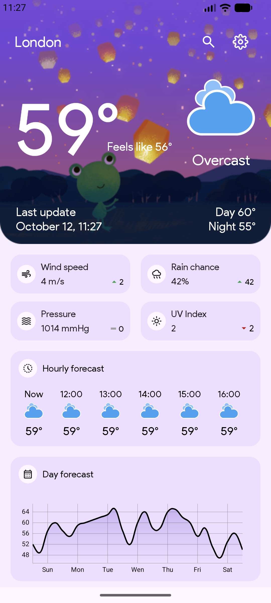
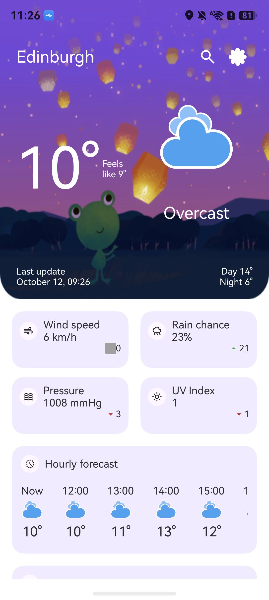
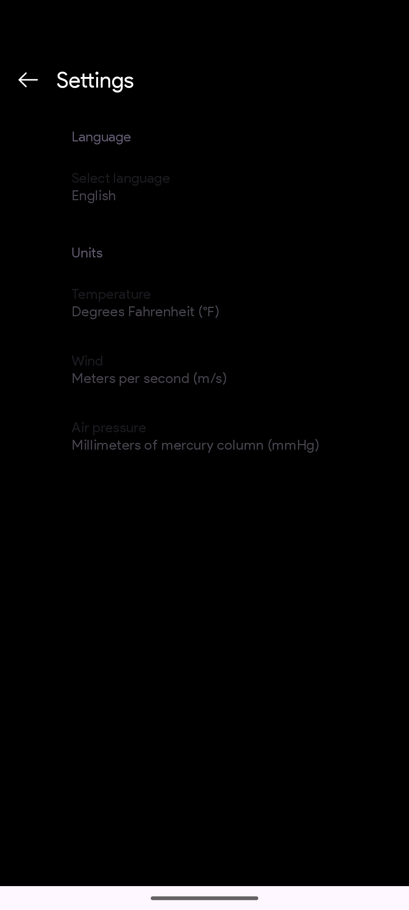
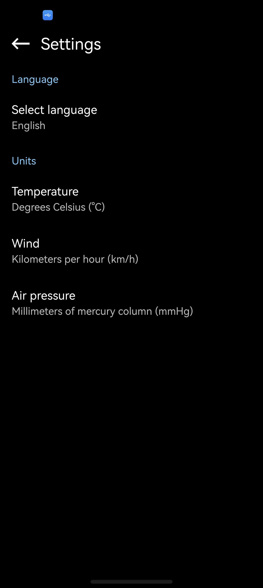
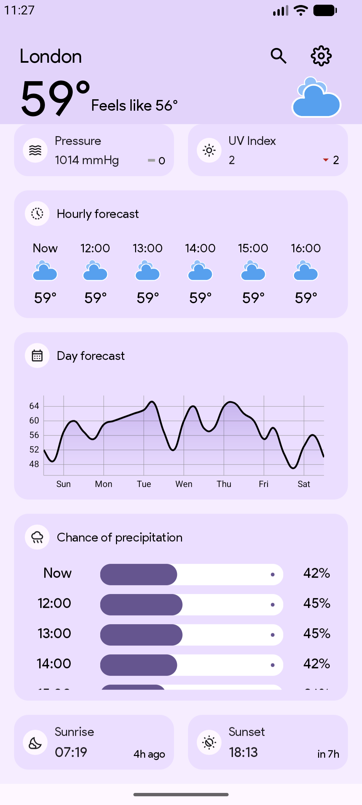
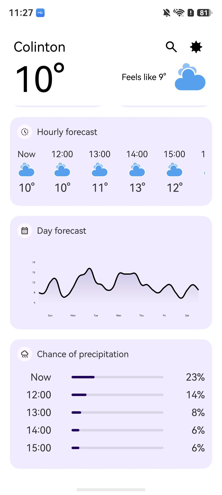

# WeatherApp-Codex-Report — 迁移评估报告 / Migration Assessment Report

报告日期 / Report date: 2026-10-12 (Europe/London)  
评估范围 / Scope: Android WeatherApp → HarmonyOS WeatherAppHM。本文仅呈现最终状态，不计过程中的临时判定。

## 中文版

### 1. 累计消耗

| 指标 | 合并结果 |
|---|---:|
| 累计实际工作时长 | 6 小时 28 分 44 秒 |
| 起止墙钟时长（含轮间暂停） | 6 小时 57 分 47 秒 |
| DevEco 主会话及递归子会话 | 62 个 |
| 非缓存输入 token | 4,567,115 |
| 输出 token | 438,502 |
| 缓存读取输入 token | 115,730,944 |
| 缓存写入输入 token | 0 |
| **累计 token（以上类别之和）** | **120,736,561** |

使用模型为 openai/gpt-6.1-sol。222,842 个推理 token 已包含在输出 token 内，没有重复相加。统计覆盖 DevEco 迁移主会话及全部递归子会话，不含本 Codex 桌面聊天的用量；token 使用量不代表货币费用。两段工作已合并，不分别列账。

### 2. 源应用简介与代码规模

源应用 WeatherApp 是单模块 Android/Java 天气预报应用：通过 OpenMeteo 获取当前、逐小时和逐日天气，通过 GeoNames 搜索城市，并支持设备定位、日出日落、温度/气压/风速单位选择及多语言显示。迁移目标 WeatherAppHM 是对应的 HarmonyOS/ArkTS 应用。

| 统计对象 | 文件数 | 物理行数 |
|---|---:|---:|
| 源工程生产 Java/Kotlin 代码 | 30 | 3,237 |
| 源工程界面布局 XML | 9 | 1,017 |
| 源工程 Protobuf 模式定义 | 14 | 172 |
| 目标工程生产 ETS（不含生成的 Protobuf 代码） | 18 | 3,338 |
| 目标工程生成的 Protobuf ETS | 15 | 3,390 |

统计口径为相应源文件的物理行数，包含空行和注释；源侧限定 `app/src/main` 的 Java/Kotlin、`res/layout` 的 XML 和 `proto` 文件，目标侧限定 `entry/src/main/ets` 的 `.ets` 文件。未计测试、依赖、构建产物、图片、其他资源或备份。主代码对照为源侧 3,237 行与目标侧非生成 ETS 3,338 行；布局、模式定义和生成代码单列，不能把总行数差异直接解释为迁移效率或功能覆盖率。

### 3. 工作流主要行为与分支点

| 阶段 | 主要行为与关键分支 |
|---|---|
| 可行性与前场 | 扫描 Android 源码及环境，创建鸿蒙骨架，转换资源/路由/布局并完成首屏冒烟；签名未就绪时按流程走未签名调试链，待用户完成签名后恢复实体设备路径。 |
| 规格基线 | 从源码提取页面、数据与设备能力契约，冻结 6 个迁移切片和 113 条功能断言；后续仅定向续跑失败片，不重建台账或改变分母。 |
| 开发与确定性门 | 实现 ArkTS 页面、天气服务、位置与持久化；对于二进制设置存储，采用官方 Protobuf 实现及源工程 14 个模式定义，而非将缺口视作通过；持续执行构建、接口/向量和代码闭合检查。 |
| 末端验收分支 | 对失败切片定向复验：初始化切片因真实二进制存储闭合而通过；首页切片因头部恢复及复合交互证据不足而保持未通过。未观察到的时间性动画和边界交接保持未验证。 |
| 运行时验证分支 | 桌面 LocalTest 无法加载 Protobuf 的 ELF 原生库，转由已签名测试包在实体设备运行；原生用例与三条核心路径通过，但大致定位在正确授权后仍返回 201，达到限定尝试次数后停止，不以精确定位通过代替。 |
| 发布回流 | 修复闭合检查指出的文件异常处理和目标 SVG 问题，复验签名构建与实体显示，最终代码硬违规清零；台账核验通过，但验收门和运行时门仍未通过，因此只报告部分完成。 |

### 4. 最终工作流结果

**总体结论：产物能够签名、构建并在实体设备运行，但全量迁移验收未通过。** 六个迁移切片中五个已验收，首页切片未通过。冻结的 113 条功能断言中，105 条通过、4 条失败、4 条未验证、0 条豁免。分类结果为：后端 63 通过/1 失败；界面 37 通过/2 失败/4 未验证；真机专属 5 通过/1 失败。

| 最终关卡 | 结果 | 判定范围 |
|---|---|---|
| 签名构建与安装 | 通过 | 主应用和测试 HAP 均签名并在实体设备安装 |
| 最终代码闭合检查 | 通过 | 硬违规 0 |
| 台账完整性核验 | 通过 | 冻结分母、证据及必需门记录符合流程 |
| 单元行为验收 | **未通过** | 首页复合行为契约未闭合 |
| 运行时验证门 | **未通过** | 大致定位场景失败，核心路径通过不能覆盖该失败 |

实体设备原生测试 43/43 通过，文件异常处理定向回归 3/3 通过，精确定位用例 1/1 通过。城市搜索和选择、非默认温标及语言的冷恢复、天气详情等三条核心路径均走通。系统位置服务关闭时的提示、设置跳转与返回已验证，测试后位置服务也确认恢复为开启。这些结果只证明各自覆盖的行为。桌面 LocalTest 无法加载二进制序列化库的 ELF 原生模块，因此不能报告为桌面测试通过；相关测试实际在实体设备运行。没有独立的完整 PRD 场景全集，因此不计算 PRD 场景覆盖率。

### 5. 未通过的四条断言

| 断言 | 最终原因 |
|---|---|
| DP-A25 气压单位 | 源实现将 OpenMeteo 的 hPa 数据标作用户选定单位，随后又按该标签转换；冻结验收要求与忠实复现源行为冲突。没有擅自修改行为或豁免，需明确选择源行为复现还是正确单位语义。 |
| DP-A08 大致定位 | 已正确授予大致定位并拒绝精确定位，但实体设备原生低功耗定位调用两次返回错误码 201。精确定位成功不能替代此项，也没有足够证据断定是平台缺陷。 |
| WUI-A13 首页头部恢复 | 上滑收缩后，三次限定下滑尝试均未达到展开端点。代码虽有调整，仍缺修复后的成功行为证据。 |
| WUI-A35 复合界面风险 | 小时列表真实 MOVE 隔离等局部行为已证实，但降水列表边界交接、刷新协同、头部恢复及长文本无遮挡未被完整证实，首页切片因此未收敛。 |

### 6. 仍未验证的四条断言

| 断言 | 尚缺的证据 |
|---|---|
| SS-A01 设置入场 | 设置与返回可用，未捕获右侧滑入的中间动画帧。 |
| WUI-A12 下拉刷新 | 已见下拉及最终天气状态，未独立观察刷新进度出现、结束及其因果顺序。 |
| WUI-A20 日图交互 | 静态曲线实现已核对，点选标记及一秒动画等时间行为未被实际观察。 |
| WUI-A21 降水内滚 | 有界列表与内部滚动已有证据，末项可达性及内外双边界交接未被实际观察。 |

这四项并非统一的“真机阻塞”：源码检查和模拟器走查已用于能证明的部分，未观察到的部分保持未验证。另有四项已登记的视觉近似实现，不构成功能断言的自动豁免。**最终判定为部分完成，不可宣称全量迁移验收通过。**

## English version

### 1. Cumulative consumption

| Metric | Combined total |
|---|---:|
| Active work time | 6 h 28 min 44 s |
| End-to-end wall time, including the pause between work periods | 6 h 57 min 47 s |
| DevEco parent and recursive child sessions | 62 |
| Non-cached input tokens | 4,567,115 |
| Output tokens | 438,502 |
| Cached-read input tokens | 115,730,944 |
| Cached-write input tokens | 0 |
| **Total tokens (sum of the categories above)** | **120,736,561** |

The model was openai/gpt-6.1-sol. The 222,842 reasoning tokens are included in output tokens and are not added again. Accounting covers the DevEco migration session and all recursive child sessions; usage from this Codex desktop conversation is unavailable and excluded. Token usage is not a monetary cost. Both work periods are presented as one cumulative total.

### 2. Source application and code size

The source, WeatherApp, is a single-module Android/Java weather app. It uses OpenMeteo for current, hourly, and daily forecasts and GeoNames for city search. It also supports device location, sunrise/sunset information, selectable temperature/pressure/wind units, and multiple languages. WeatherAppHM is the corresponding HarmonyOS/ArkTS migration target.

| Counted material | Files | Physical lines |
|---|---:|---:|
| Source production Java/Kotlin code | 30 | 3,237 |
| Source UI layout XML | 9 | 1,017 |
| Source Protobuf schemas | 14 | 172 |
| Target production ETS, excluding generated Protobuf code | 18 | 3,338 |
| Target generated Protobuf ETS | 15 | 3,390 |

Counts are physical source-file lines, including blank lines and comments. The source scope is Java/Kotlin under `app/src/main`, XML under `res/layout`, and `proto` files; the target scope is `.ets` files under `entry/src/main/ets`. Tests, dependencies, build outputs, images, other resources, and backups are excluded. The primary code comparison is 3,237 source lines versus 3,338 non-generated target ETS lines. Layouts, schemas, and generated code are separate; differences in line totals do not by themselves measure migration efficiency or functional coverage.

### 3. Main workflow actions and decision points

| Stage | Main action and branch |
|---|---|
| Feasibility and front-end | Inspected Android source and environment, created the HarmonyOS scaffold, converted resources/routes/layouts, and smoke-tested launch. When signing was unavailable, the workflow used an unsigned debugging path; physical-device work resumed after the user completed signing. |
| Specification baseline | Extracted page, data, and device-capability contracts from source and froze six migration slices and 113 functional assertions. Subsequent work reran only failed slices, without reinitializing the ledger or changing the denominator. |
| Development and deterministic gates | Implemented ArkTS pages, weather services, location, and persistence. Binary settings storage used an official Protobuf implementation with the source's 14 schemas instead of treating the gap as passed. Build, interface/vector, and code-closure checks ran during implementation. |
| End-stage acceptance branch | Targeted re-acceptance of failed slices: the initialization slice passed after real binary storage was completed; the main-page slice remained failed because header restoration and composite-interaction evidence did not close. Unobserved timed animations and boundary handoffs remained unverified. |
| Runtime branch | Desktop LocalTest could not load Protobuf's ELF native library, so signed tests ran on a physical device. Native cases and three core paths passed, but approximate location still returned 201 with the correct permissions; testing stopped at the bounded attempt limit, without substituting the precise-location pass. |
| Release feedback | Fixed file-error handling flagged by closure checks and target SVG defects, then rechecked signed builds and physical display. Final code closure had zero hard violations and ledger verification passed, while acceptance and runtime gates remained failed; the outcome is therefore partial completion only. |

### 4. Final workflow outcome

**Overall verdict: the migrated application builds, is signed, and runs on a physical device, but full migration acceptance has not passed.** Five of six migration slices are accepted; the main-page slice is not. Of 113 frozen functional assertions, 105 passed, 4 failed, 4 remain unverified, and none were waived. By category: backend 63 passed/1 failed; UI 37 passed/2 failed/4 unverified; device-only 5 passed/1 failed.

| Final gate | Result | What it establishes |
|---|---|---|
| Signed build and installation | Passed | Application and test HAPs were signed and installed on a physical device |
| Final code-closure check | Passed | Zero hard violations |
| Ledger integrity check | Passed | Frozen denominator, evidence, and required gate records satisfy the workflow |
| Behavioral acceptance | **Failed** | The main-page composite behavior remains unresolved |
| Runtime validation | **Failed** | Approximate-location behavior failed; passing core flows does not override this gate |

On the physical device, the native suite passed 43/43 cases, targeted file-I/O error-handling regression passed 3/3, and the precise-location case passed 1/1. All three core flows succeeded, including city search and selection, cold restoration of non-default units and language, and access to weather details. The disabled-location prompt, system-settings handoff, and return to the app were observed; the device's location service was confirmed enabled again after testing. These results support only the behaviors they exercise. Desktop LocalTest could not load the ELF native module used by the binary serialization library, so it is not represented as a desktop test pass; the relevant native cases ran on the physical device. No independent complete PRD scenario set was supplied, so no PRD scenario coverage percentage is claimed.

### 5. Four failed assertions

| Assertion | Final reason |
|---|---|
| DP-A25 pressure units | The source labels OpenMeteo hPa data with the user's selected unit and then converts according to that label. The frozen requirement conflicts with faithfully reproducing that behavior. No product behavior was silently changed and no waiver was granted; source fidelity versus corrected unit semantics needs a decision. |
| DP-A08 approximate location | Approximate permission was granted and precise permission denied on the physical device, but the native low-power location call returned error 201 twice. The successful precise-location case does not establish approximate-location support, and the evidence does not establish a platform defect. |
| WUI-A13 header restoration | After upward scrolling collapsed the header, three bounded downward attempts did not reach the expanded endpoint. Code was adjusted, but successful post-fix behavioral evidence is still missing. |
| WUI-A35 composite UI risk | Real hourly-list MOVE isolation and other partial behavior were demonstrated. Rain-list boundary handoff, refresh coordination, header restoration, and long-text clearance were not established as a complete contract; the main-page slice remains unaccepted. |

### 6. Four unverified assertions

| Assertion | Missing evidence |
|---|---|
| SS-A01 settings entrance | Opening settings and returning work, but intermediate frames of the right-side entrance animation were not captured. |
| WUI-A12 pull-to-refresh | The gesture and resulting weather state were observed; progress appearance, completion, and their causal sequence were not independently observed. |
| WUI-A20 daily-chart interaction | Static curve implementation was checked, but point-selection marker and timed animation behavior were not observed. |
| WUI-A21 precipitation scrolling | The bounded list and internal scrolling have supporting evidence, but reaching the last item and handing off at both boundaries were not observed. |

These four gaps are not a blanket “physical-device blocker.” Source inspection and emulator checks were used where they could establish behavior; unobserved portions remain unverified. Four declared visual approximations also remain and do not automatically waive functional assertions. **The final assessment is partially complete; full migration acceptance must not be claimed.**

## 附录：关键画面对照 / Appendix: key-screen comparisons

采集日期：2026-10-12。左侧为 Android 模拟器中运行的源应用，右侧为 HarmonyOS 实体设备中运行的迁移应用；均为本次实时截图。设备、位置、单位与天气更新时间不同，因此仅比较页面结构与可见内容，不直接比较天气数值。静态截图不构成新增功能验收。

Captured on 2026-10-12. The left side shows the source app on an Android emulator; the right side shows the migrated app on a HarmonyOS physical device. All six images were captured during this session. Device, location, units, and forecast update time differ, so the comparison concerns layout and visible content, not matching weather values. Still images add no new functional acceptance.

### 1. 天气首页 / Weather home

| Android 源应用 / Source | HarmonyOS 迁移目标 / Target |
|---|---|
|  |  |

源侧显示 London、华氏度；目标侧显示 Edinburgh、摄氏度。两侧均有天气头部、四张指标卡和逐小时预报，视觉细节与卡片间距可直接对照。

Source shows London in Fahrenheit; target shows Edinburgh in Celsius. Both show the weather header, four metric cards, and hourly forecast; visual details and spacing can be compared directly.

### 2. 设置页 / Settings

| Android 源应用 / Source | HarmonyOS 迁移目标 / Target |
|---|---|
|  |  |

两侧均有语言、温度、风速和气压单位设置。源应用在当前 Android 模拟器上的正文呈低对比度，截图保持原样；不据此推断所有 Android 设备均如此。

Both show language and temperature, wind, and pressure settings. Source text appears low-contrast on this Android emulator; the image is unaltered, and this is not a claim about every Android device.

### 3. 日图与降水 / Daily chart and precipitation

| Android 源应用 / Source | HarmonyOS 迁移目标 / Target |
|---|---|
|  |  |

两侧均可见逐小时、日图和降水区域。源侧为 London/华氏度，目标侧滚动时显示 Colinton/摄氏度。截图不能证明图表点选动画、降水末项可达或内外滚动边界交接，因此不改变 WUI-A20、WUI-A21、WUI-A35 的最终状态。

Both show hourly, daily-chart, and precipitation areas. Source is London/Fahrenheit; the scrolled target shows Colinton/Celsius. These images do not establish chart-point animation, last-item reachability, or nested-scroll boundary handoff, so the final status of WUI-A20, WUI-A21, and WUI-A35 is unchanged.

## 实测体验 / Hands-on experience

从实际使用感受看，迁移应用的基本功能可用，天气及预报等主要信息展示整体完整；仍有少量媒体资源与源应用未对齐。真机使用者观察到：手动更换城市后，下拉刷新会切回设备当前定位的城市。代码核对确认，迁移应用和 Android 源应用的下拉刷新都会重新请求当前位置；当定位已授权且返回有效坐标时，该坐标会覆盖手选位置。因此，这一现象有明确的触发机制，但不能直接定性为迁移引入的持久化缺陷。此前真机选城与冷启恢复用例是在拒绝定位权限后通过的；本次追加真机操作虽获得城市搜索结果，点选后目标城市未稳定显示，尚未形成“选城成功→刷新→切回”的完整现场复现证据。另有部分本地化问题：界面中会掺杂不同语言的文本。以上观察不构成新增断言过账或修复验证。

In hands-on use, the migrated app's basic functions work and its main weather and forecast information is broadly intact, although a small number of media assets do not yet match the source. The physical-device user observed that pull-to-refresh returned to the device's current-location city after manually choosing another city. Code review confirms that both the migrated app and the Android source request the current location on refresh; when location permission is granted and a valid coordinate is returned, it replaces the manually selected coordinate. This establishes a trigger for the behavior, but does not by itself establish a migration-induced persistence defect. The earlier physical-device city-selection and cold-start restoration test passed with location permission denied. In the additional device check, city search returned results, but the selected target city did not remain visible, so the full “selection succeeded → refresh → return to current location” sequence was not reproduced on screen. Localization also remains incomplete, with text from different languages appearing together. These observations do not add assertion results or verify a fix.

本节是追加的实测体验记录，未对上述冻结的 113 条断言重新过账，也不改变“全量迁移验收未通过”的最终结论。

This section records additional hands-on observations; it does not rebook the 113 frozen assertions or change the final verdict that full migration acceptance has not passed.
